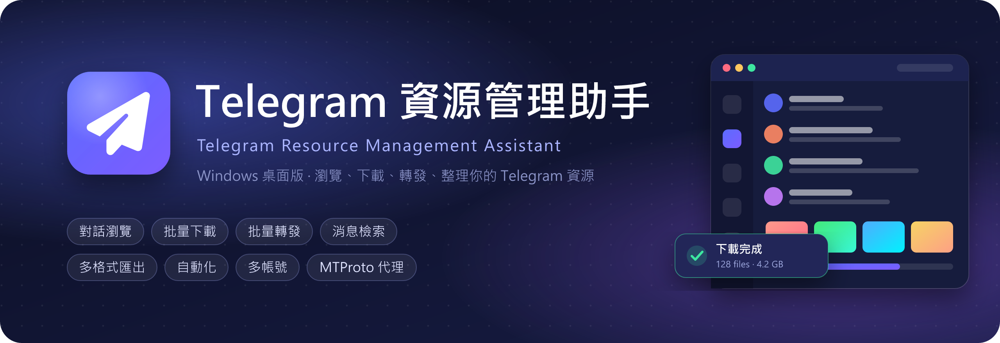
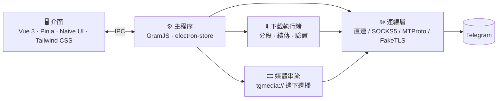

<div align="center">



<br>

**瀏覽、下載、轉發、整理你的 Telegram 資源 —— 一個視窗全部搞定。**

[](https://github.com/LaiYueJi/Telegram-RMA/releases/latest)
[](https://github.com/LaiYueJi/Telegram-RMA/releases)
[](#download)
[](LICENSE)

[](https://www.electronjs.org/)
[](https://vuejs.org/)
[](https://vite.dev/)
[](https://tailwindcss.com/)
[](https://github.com/gram-js/gramjs)

[**功能特色**](#features) ·
[**下載安裝**](#download) ·
[**快速上手**](#quick-start) ·
[**常見問題**](#faq) ·
[**從原始碼建置**](#build)

</div>

<br>

## 🌟 亮點

<table>
<tr>
<td width="25%" align="center" valign="top">
<h3>📥</h3>
<b>下載不怕斷</b><br>
<sub>暫停、續傳、憑證過期自動更新；沒下完的檔案不會被當成成功</sub>
</td>
<td width="25%" align="center" valign="top">
<h3>🎯</h3>
<b>條件精準篩選</b><br>
<sub>日期、關鍵字、成員、媒體類型、檔案大小、影片長度，一次設好</sub>
</td>
<td width="25%" align="center" valign="top">
<h3>👥</h3>
<b>多帳號一鍵切換</b><br>
<sub>掃碼／手機登入、Session 匯入匯出、tdata 互轉</sub>
</td>
<td width="25%" align="center" valign="top">
<h3>🔒</h3>
<b>資料只在本機</b><br>
<sub>登入狀態與記錄都存在你的電腦，不經過任何第三方伺服器</sub>
</td>
</tr>
</table>

<a id="features"></a>

## ✨ 功能特色

<table>
<tr>
<td width="50%" valign="top">

### 💬 對話瀏覽
- 對話清單支援 Telegram **資料夾分頁**、封存對話，「我的收藏」置頂
- 圖片燈箱：縮放、旋轉、拖曳、全螢幕
- 影片**邊下載邊播放**，支援倍速、子母畫面
- **共享媒體面板**：照片／影片／檔案分類瀏覽，日曆直接跳到某一天
- 貼上 `@用戶名`、`t.me` 連結或電話即可加入對話

</td>
<td width="50%" valign="top">

### ⬇️ 批量下載
- 依 **日期、關鍵字（含／排除）、成員、媒體類型、檔案大小、影片長度** 篩選
- 圖片、影片、GIF、音訊、語音、文件分類下載
- 多檔並行，自訂**資料夾結構**與**檔名規則**
- 中斷後可續傳，失敗項目一鍵重試
- 下載完成會驗證檔案大小，壞檔不會留下

</td>
</tr>
<tr>
<td width="50%" valign="top">

### 🔁 批量轉發
- 選擇來源與目標對話，依條件批量轉發
- 可**隱藏原作者**（不顯示「轉發自」）
- 遇到 Telegram 頻率限制自動等待，隨時暫停／繼續

</td>
<td width="50%" valign="top">

### 🔎 消息檢索
- 搜尋單一對話或**全部對話**
- 依訊息類型、時間範圍篩選
- 搜尋結果可直接下載、複製連結、匯出，或整批丟進下載任務

</td>
</tr>
<tr>
<td width="50%" valign="top">

### 📤 多格式匯出
- **Excel、CSV、TXT、JSON、HTML** 五種格式
- HTML 是單一檔案的**離線聊天記錄**，內建搜尋，雙擊就能看
- 保留完整換行、回覆與轉發來源、訊息連結

</td>
<td width="50%" valign="top">

### ⏰ 自動化
- **監聽新訊息**：符合條件（類型、關鍵字、大小）就自動下載
- **定時排程**：依時間表自動建立下載任務
- 每個帳號的規則各自獨立

</td>
</tr>
<tr>
<td width="50%" valign="top">

### 🗂️ 任務台與通知
- 下載、轉發任務集中管理：進度、速率、剩餘時間一目了然
- 每個檔案都能**跳回原訊息位置**
- 清除已完成、批次移除（可選擇連本機檔案一起刪除）
- 通知中心隨時查看進行中的任務

</td>
<td width="50%" valign="top">

### 👥 帳號管理
- 保存多個帳號，**一鍵切換**
- 掃碼登入、手機驗證碼、兩步驟驗證
- **Session 字串**匯入／匯出（GramJS、Telethon 格式，可批量）
- **Session ↔ tdata**（Telegram Desktop 資料夾）互相轉換
- 帳號健康檢測、修改個人資料、設定兩步驟驗證、登出其他裝置

</td>
</tr>
<tr>
<td width="50%" valign="top">

### 🌐 代理連線
- 支援 **SOCKS5** 與 **MTProto**（含 `dd`、`ee` FakeTLS 金鑰）
- 貼上 `tg://proxy` 或 `t.me/proxy` 連結自動填入
- 保存多組代理，點一下就切換

</td>
<td width="50%" valign="top">

### 🎨 介面與體驗
- **深色／淺色**主題，多款**背景漸層**可選
- 無邊框視窗、即時網速顯示
- 關閉視窗時可選擇**縮到系統匣**繼續下載
- 設定、任務與自動化規則可一鍵**備份／還原**
- 全繁體中文介面

</td>
</tr>
</table>

<a id="download"></a>

## 📦 下載安裝

到 [**Releases**](https://github.com/LaiYueJi/Telegram-RMA/releases/latest) 下載最新版本：

<div align="center">

[](https://github.com/LaiYueJi/Telegram-RMA/releases/latest)

</div>

| 檔案 | 說明 |
|:--|:--|
| `Telegram-RMA-Setup-<版本>.exe` | **安裝版**（推薦）— 可選安裝位置，建立桌面與開始選單捷徑 |
| `Telegram-RMA-Portable-<版本>.exe` | **免安裝版** — 單一檔案，雙擊即用 |

> [!NOTE]
> 安裝檔沒有數位簽章，第一次執行時 Windows 可能跳出「Windows 已保護您的電腦」，點 **其他資訊 → 仍要執行** 即可。

<a id="quick-start"></a>

## 🚀 快速上手

```
① 設定代理（選用） → ② 登入帳號 → ③ 選擇對話 → ④ 瀏覽、下載、轉發
```

1. **設定代理**：如果你的網路無法直接連上 Telegram，先點登入頁的「**設定代理**」，貼上代理連結。
2. **登入**：用手機 Telegram 掃 QR Code，或改用手機號碼＋驗證碼登入。
3. **選擇對話**：左側清單點一個對話，就能瀏覽訊息與媒體。
4. **開始使用**：工具列上有「批量下載」「批量轉發」「文本導出」，進度都會出現在「任務台」。

> [!TIP]
> 下載的檔案預設存在 `下載\Telegram-RMA`，可以在對話工具列的「**保存到**」更改；建立批量下載任務時也能另外指定。

<a id="faq"></a>

## ❓ 常見問題

<details>
<summary><b>需要自己申請 api_id / api_hash 嗎？</b></summary>
<br>

不需要，程式內建預設值，直接登入即可。如果想用自己的，到 [my.telegram.org](https://my.telegram.org) 申請後，在登入頁的「進階」填入。

</details>

<details>
<summary><b>我的登入資訊存在哪裡？安全嗎？</b></summary>
<br>

設定、登入狀態與任務記錄都存在本機的 `%APPDATA%\Telegram-RMA`，程式只會連到 Telegram（或你設定的代理），不會傳到任何其他伺服器。

「備份資料」匯出的 JSON **不含**登入 session、API 憑證與代理設定，可以放心保存。

</details>

<details>
<summary><b>為什麼有些影片不能在程式裡播放？</b></summary>
<br>

MKV、AVI 等格式內建播放器不支援，下載後用電腦上的播放器開啟即可。

</details>

<details>
<summary><b>下載速度很慢怎麼辦？</b></summary>
<br>

下載速度主要取決於 Telegram 伺服器與網路線路。直連時會開多條連線並行下載；走代理時為了穩定改用單一連線，速度會受代理品質影響，建議換延遲較低的代理。

</details>

<details>
<summary><b>tdata 轉換失敗？</b></summary>
<br>

如果 Telegram Desktop 有設定「本機密碼」，tdata 會被加密而無法讀取，請先在 Telegram Desktop 關閉本機密碼再轉換。

</details>

<details>
<summary><b>安裝版和免安裝版可以一起用嗎？</b></summary>
<br>

可以，兩者共用同一份設定與登入狀態，隨時互換。

</details>

<a id="build"></a>

## 🛠️ 從原始碼建置

需要 [Node.js](https://nodejs.org/) 22 以上（建議 24）。

```bash
git clone https://github.com/LaiYueJi/Telegram-RMA.git
cd Telegram-RMA
npm ci

npm run dev     # 開發模式（熱更新）
npm run dist    # 打包 Windows 安裝版與免安裝版 → dist/
```

<details>
<summary><b>其他指令</b></summary>
<br>

| 指令 | 用途 |
|:--|:--|
| `npm run build` | 只建置程式碼到 `out/` |
| `npm run start` | 以正式建置執行 |
| `npm run dev:debug` | 開發模式＋下載／代理的除錯記錄 |
| `npm run icon` | 重新產生 app 圖示 |
| `node scripts/make-banner.mjs` | 重新產生 README 橫幅 |

</details>

<details>
<summary><b>發佈新版本</b></summary>
<br>

修改 `package.json` 的 `version`，推送同版本的標籤，GitHub Actions 就會自動打包並發佈 Release：

```bash
git tag v1.2.3
git push origin v1.2.3
```

</details>

## 🧱 技術架構



| 層 | 使用技術 |
|:--|:--|
| 桌面框架 | [Electron](https://www.electronjs.org/) + [electron-vite](https://electron-vite.org/) |
| 介面 | [Vue 3](https://vuejs.org/) · [Pinia](https://pinia.vuejs.org/) · [Naive UI](https://www.naiveui.com/) · [Tailwind CSS](https://tailwindcss.com/) · [Lucide](https://lucide.dev/) |
| Telegram 協定 | [GramJS](https://github.com/gram-js/gramjs) · [mtcute](https://github.com/mtcute/mtcute)（Session／tdata 轉換） |
| 媒體與匯出 | [Plyr](https://plyr.io/) · [ExcelJS](https://github.com/exceljs/exceljs) |
| 排程與儲存 | [node-cron](https://github.com/node-cron/node-cron) · [electron-store](https://github.com/sindresorhus/electron-store) |

<details>
<summary><b>專案結構</b></summary>
<br>

```
Telegram-RMA
├─ src
│  ├─ main                 # 主程序
│  │  ├─ telegram          # 登入、對話、下載、轉發、檢索、匯出、自動化、代理
│  │  ├─ ipc               # 主程序 ↔ 介面的通訊介面
│  │  ├─ store             # 設定與任務資料
│  │  └─ net               # 網速統計
│  ├─ preload              # 安全橋接層
│  └─ renderer/src         # 介面
│     ├─ views             # 對話、檢索、自動化、任務台、帳號…
│     ├─ components        # 對話框、播放器、清單元件
│     └─ stores            # Pinia 狀態
├─ resources               # 圖示
├─ scripts                 # 開發與產生素材的腳本
└─ .github/workflows       # 自動打包發佈
```

</details>

## ⚠️ 注意事項

- 本專案**不是** Telegram 官方產品，與 Telegram 無任何關聯。
- 使用時請遵守 [Telegram 服務條款](https://telegram.org/tos)，只下載、轉發你有權使用的內容。
- 短時間內大量轉發或頻繁操作，可能觸發 Telegram 的頻率限制甚至帳號限制，請斟酌使用。

## 🙏 致謝

- [GramJS](https://github.com/gram-js/gramjs) — Telegram MTProto 用戶端函式庫
- [mtcute](https://github.com/mtcute/mtcute) — Session 與 tdata 轉換
- [telethon-faketls](https://github.com/RevEngine3r/telethon-faketls) — FakeTLS 代理握手實作參考
- [WebGradients](https://webgradients.com/) — 背景漸層主題配色
- 以及所有開源相依套件的作者們

## 📄 授權

以 [MIT License](LICENSE) 授權釋出。

<div align="center">
<br>
<sub>如果這個專案對你有幫助，歡迎點個 ⭐ Star 支持一下！</sub>
</div>
